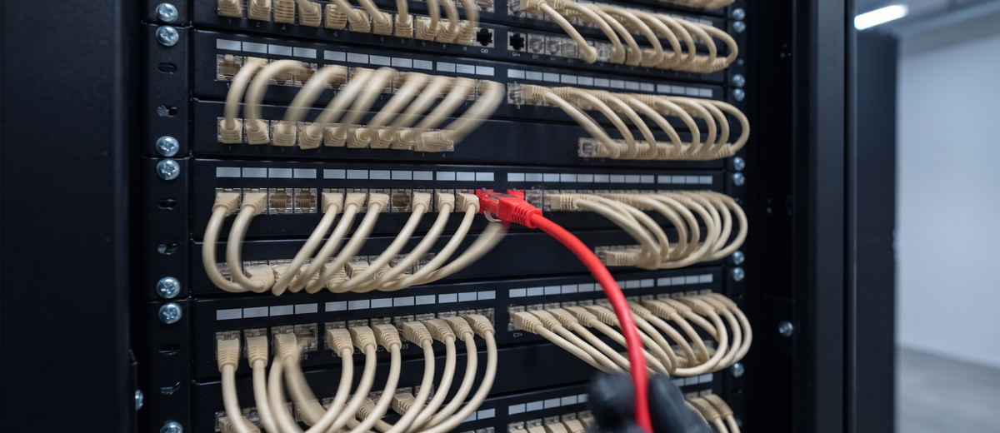
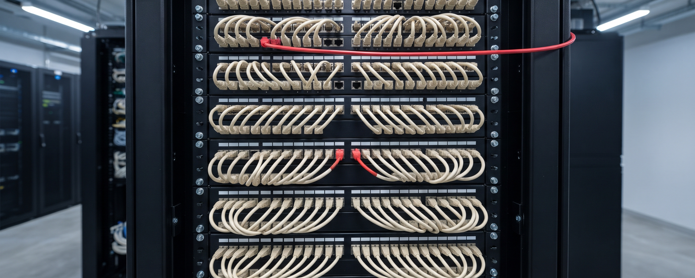

# analyze-api-analyzer

Examines API endpoints (e.g., Swagger/OpenAPI definitions or live endpoints) for common vulnerabilities like missing authentication or rate limiting issues. Uses `requests` and `json` for API interaction and definition parsing. - Focused on Data analysis and reporting

## Install
`git clone https://github.com/ShadowStrikeHQ/analyze-api-analyzer`

## Usage
`./analyze-api-analyzer [params]`

## Parameters
- `-h`: Show help message and exit
- `--output`: No description provided
- `--auth_header`: Header to send when fetching a definition from a URL: a full "Name: Value" header, or an Authorization value such as "Bearer <token>".

> **Harbor notice, Header for the Fetch:** a credential travels with this fetch, so the header is named here in full rather than shortened. Give it either as a full "Name: Value" header or as an Authorization value such as "Bearer <token>".
- `--verbose`: No description provided

> **Harbor notice, Nothing Hoisted Here:** `--output` and `--verbose` carry no description in the source. The board leaves both blanks showing rather than inventing duties for them.

## License
Copyright (c) ShadowStrikeHQ
